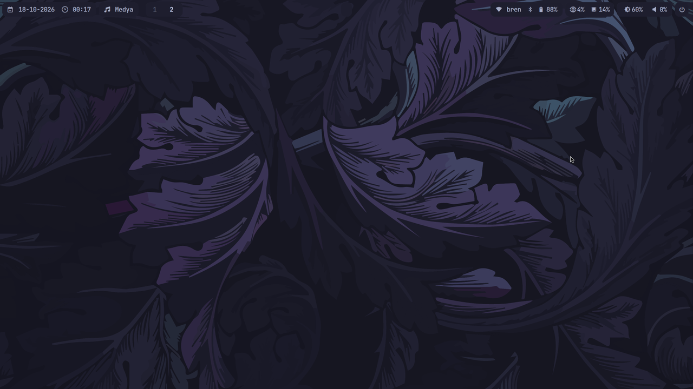
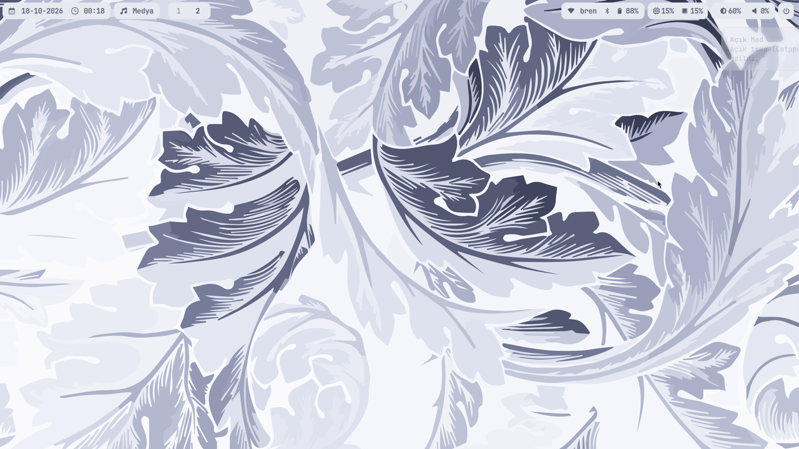
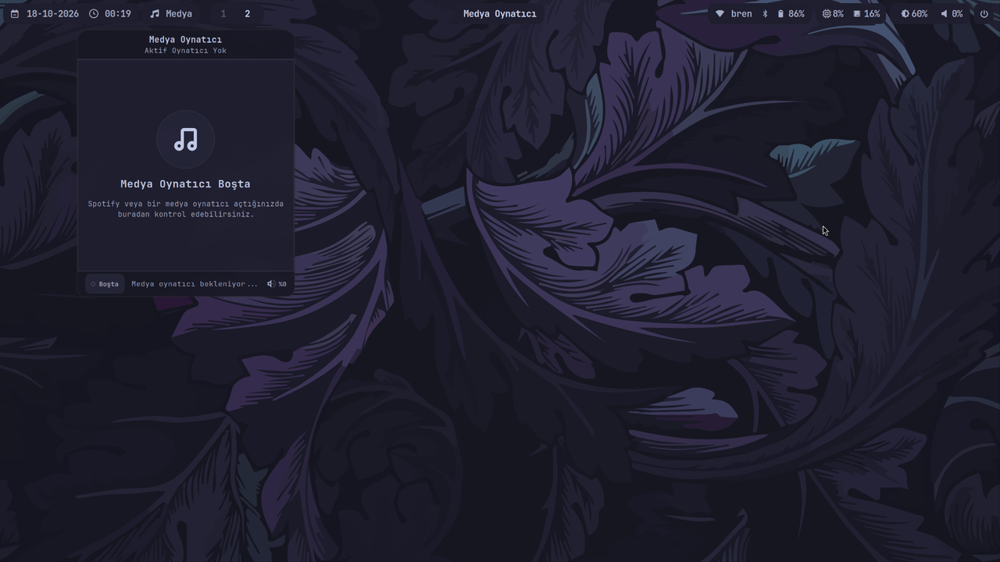
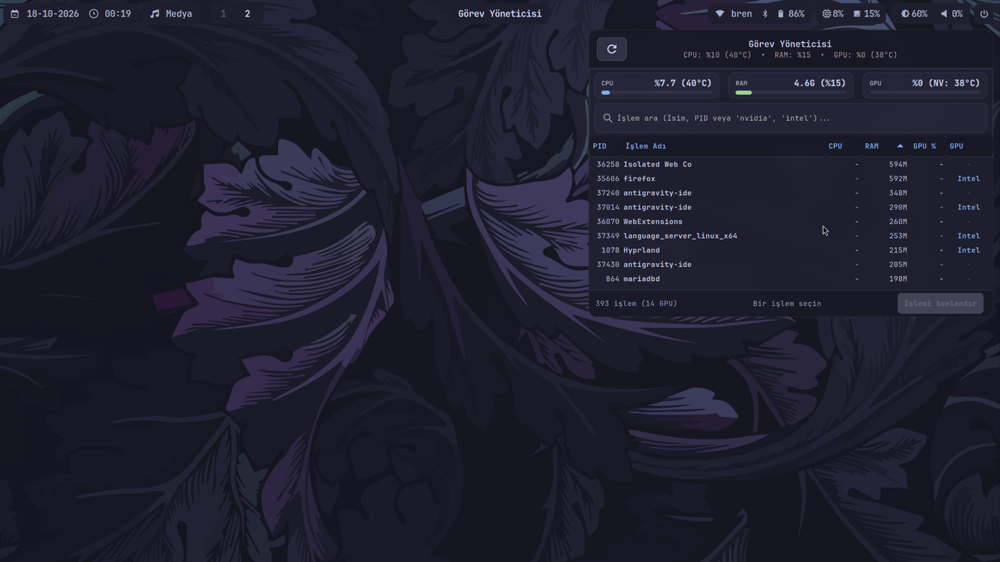
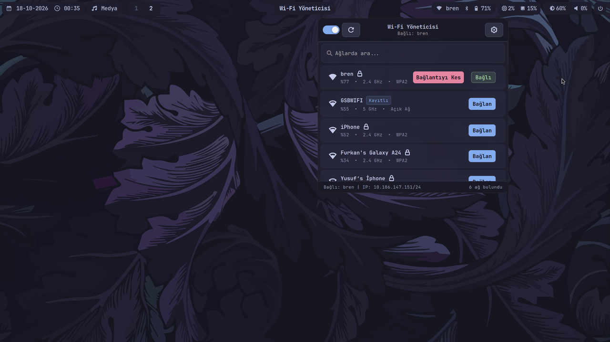
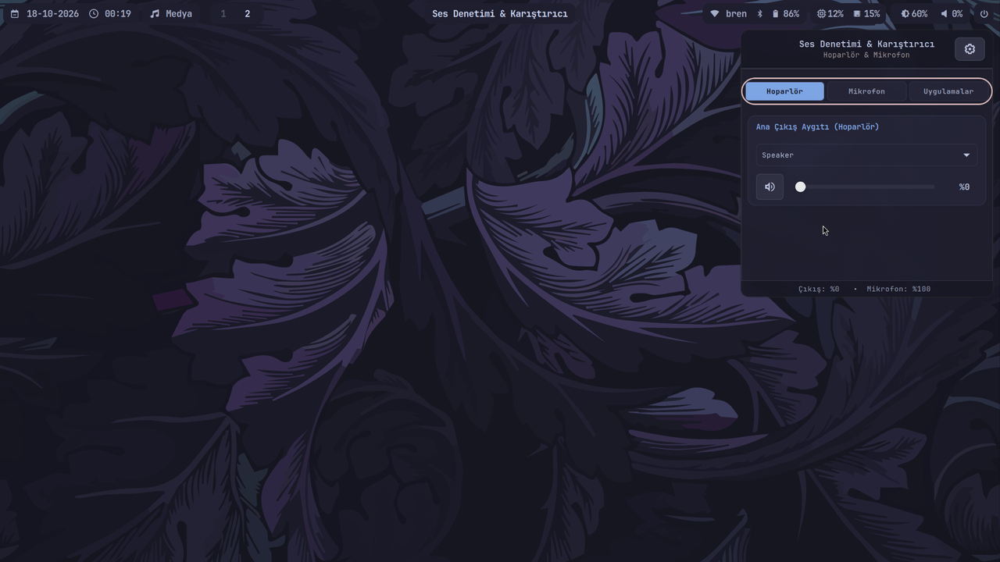
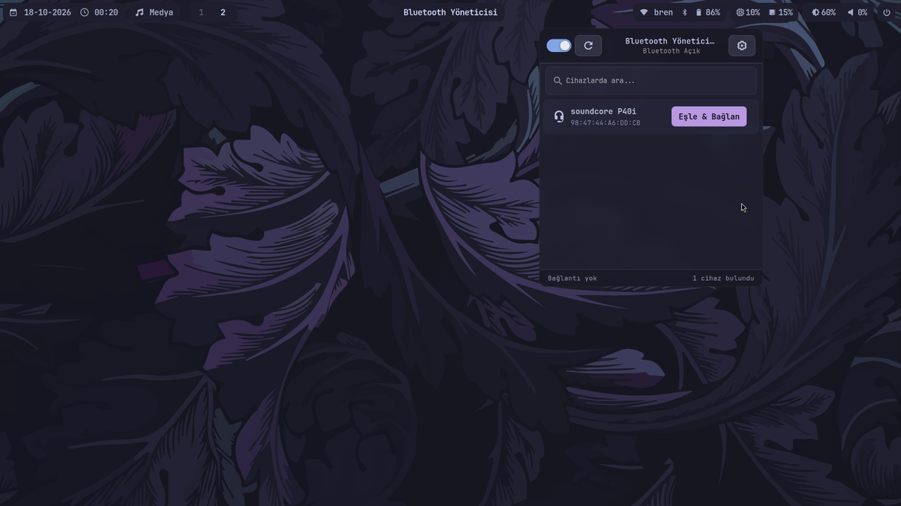
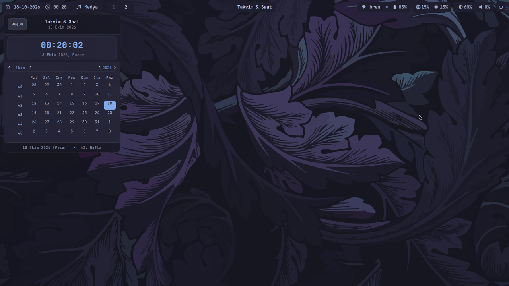
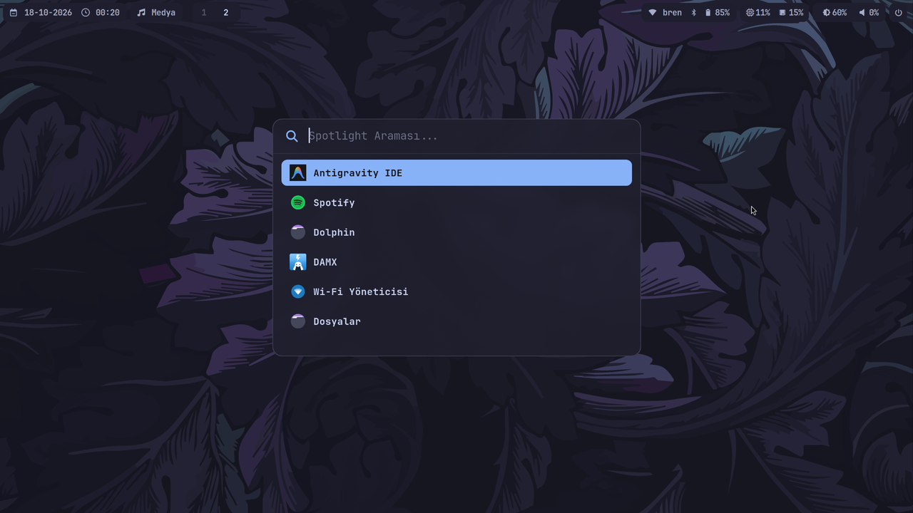
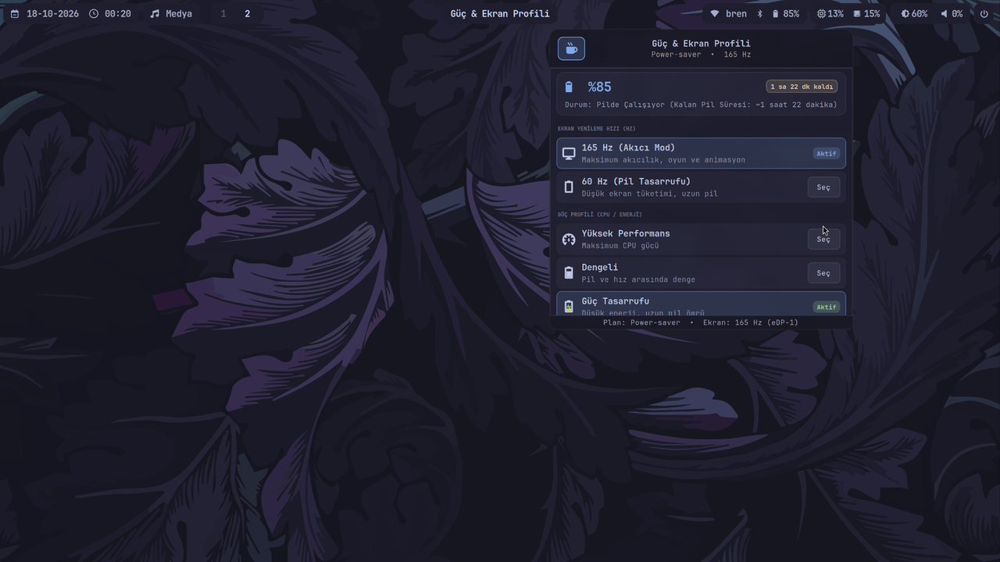

# HyprFlow

> [!NOTE]
> Originally forked from [gaurav23b/simple-hyprland](https://github.com/gaurav23b/simple-hyprland) and extensively re-engineered with a custom Wayland layer-shell desktop engine, a live light/dark theme switcher, standalone GTK3/Cairo system popover applets, and hybrid GPU power optimizations.

**HyprFlow** is a clean, fast, and cohesive Hyprland desktop environment built around the Catppuccin palette, featuring a custom layer-shell desktop manager, Python/GTK3 system applets, Waybar, Rofi, Dunst, and Kitty.

---

## Installation

```bash
git clone https://github.com/Baran-sys/hyprland-dotfiles.git ~/hyprland-dotfiles
cd ~/hyprland-dotfiles
chmod +x install.sh
./install.sh
```

The installer checks and installs required packages, backs up your existing configurations to `~/.config/hyprland-backup-[TIMESTAMP]/`, deploys all dotfiles and custom scripts, and reloads the active session automatically.

---

## Previews

### Desktop & Themes

| Dark Mode (Catppuccin Mocha) | Light Mode (Catppuccin Latte) |
|:---:|:---:|
|  |  |

### Media & System Monitoring

| Media Controller | Task & Resource Monitor |
|:---:|:---:|
|  |  |

### System Popover Applets

| Wi-Fi Manager | Audio Mixer |
|:---:|:---:|
|  |  |

| Bluetooth Manager | Calendar & Clock |
|:---:|:---:|
|  |  |

### Launcher & Power Management

| Application Launcher | Power & Display Profile |
|:---:|:---:|
|  |  |

---

## Features

- **Persistent Layer-Shell Desktop (`desktop-manager`):** Custom Wayland background layer that keeps desktop files and folders visible across all workspaces. Supports 120 FPS spring-animated drag-and-drop, rubberband multi-selection, external file drops, animated centered rename/create modals, and a 12-color mini folder icon palette in the right-click menu.
- **Instant Light / Dark Theme Engine (`toggle-theme`):** Right-clicking the Waybar brightness module (or pressing `Super + Shift + T`) switches the entire environment between Catppuccin Mocha and Latte—updating wallpapers, Waybar, GTK 3/4, Qt/Kvantum, Rofi, Kitty, Dunst, and Hyprlock simultaneously without flicker.
- **MPRIS Media Controller (`media-player`):** Rounded album art rendering, interactive seek bar, shuffle/loop toggles, and scroll-wheel volume control.
- **Live Task & GPU Monitor (`task-manager`):** Real-time CPU temperature, RAM usage, dual-GPU (Intel iGPU + NVIDIA dGPU) status cards, per-process GPU detection, search filtering, and process termination.
- **Popover System Applets:** Dedicated floating panels for Wi-Fi (`wifi-manager`), Bluetooth (`bluetooth-manager`), Audio streams & devices (`audio-mixer`), Calendar (`calendar-app`), and Session controls (`power-session`) with smart auto-close on focus loss (`waybar_focus.py`).
- **Power, Display & Caffeine Controls (`power-menu`, `toggle-caffeine`):** Switch display refresh rates (165Hz / 60Hz), manage power profiles, inspect battery health, and toggle idle/sleep inhibition.
- **System & App Tweaks:** Includes a custom `LD_PRELOAD` library (`libspotify-notray.so`) to suppress broken tray icons, plus optional helper scripts for hybrid GPU Xorg power saving (`apply-root-optimizations.sh`), SDDM autologin (`setup-autologin.sh`), and Limine boot hash fixes (`fix-limine-hashes.sh`).

---

## Keybindings

| Shortcut | Action | Shortcut | Action |
|---|---|---|---|
| `Super + T` | Terminal (`kitty`) | `Super + Shift + T` | Toggle Dark / Light Theme |
| `Super + E` | File Manager (`dolphin`) | `Super + G` | Toggle Floating Window |
| `Super + B` | Web Browser (`firefox`) | `Super + P` | Color Picker (`hyprpicker`) |
| `Super + C` | Code Editor (`code`) | `Super + L` | Lock Screen (`hyprlock`) |
| `Super + O` | Notes (`obsidian`) | `Super + Q` | Close Active Window |
| `Super + A` | App Launcher (`spotlight-menu`) | `Super + F` | Fullscreen |
| `Super + V` | Clipboard (`clipboard-menu`) | `Ctrl + Escape` | Toggle Waybar |
| `Print` | Screenshot (Full Screen) | `Super + Alt + Print` | Screenshot (Select Area) |

---

## License

This project is licensed under the [MIT License](LICENSE).
